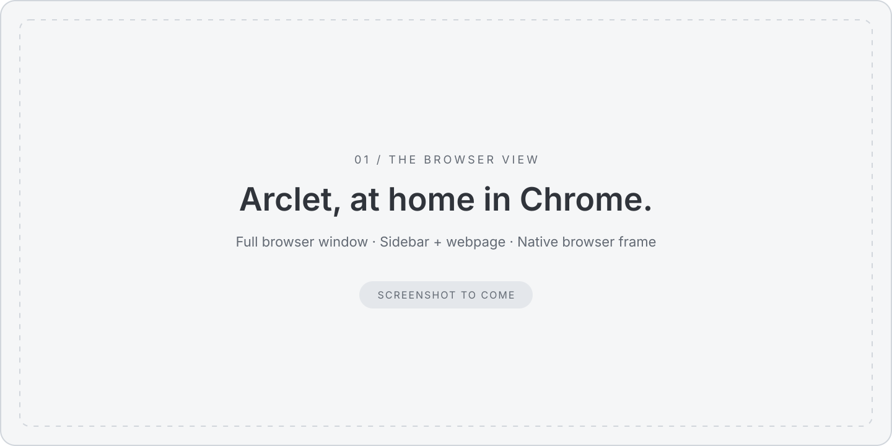
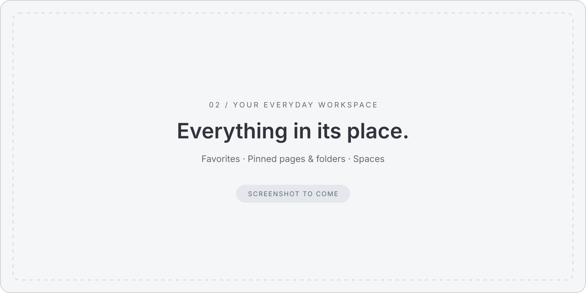
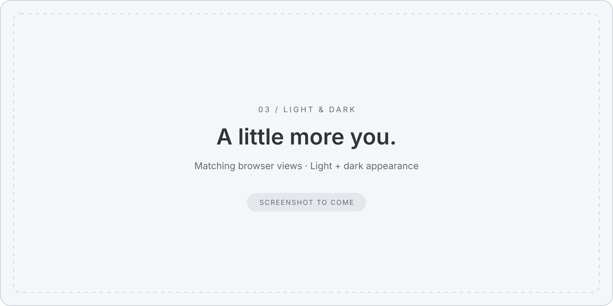

  
  <h1>Arclet</h1>
  <h3>A calmer home for your tabs.</h3>
  
Your work, your everyday favorites, your next rabbit hole. Give them a little space, right inside Chrome.

  
<strong>Vertical tabs · Spaces · Favorites · Pinned folders</strong>

  
<a href="#make-room-for-a-calmer-browser">Get started</a> &nbsp;·&nbsp; <a href="#a-place-for-every-part-of-your-day">Explore Arclet</a> &nbsp;·&nbsp; <a href="docs/reference.md">Documentation</a>

An Arc-inspired sidebar that feels at home beside the page.

<!-- SCREENSHOT 01 — Replace the image above with a real full-window Chrome capture.
Show Arclet on the left, a useful webpage on the right, and Chrome's real browser
frame, including its tab strip. Keep enough of the page visible to show how the
sidebar fits into everyday browsing. Use realistic, non-sensitive sample data. -->

## A place for every part of your day

Work in one space. Plan a trip in another. Keep the interesting things for later.
Arclet gives each part of your day its own set of tabs, with a name, color, and
icon that make it easy to find your way back.

Switch spaces when your focus changes. Drag a tab across when it belongs somewhere else.

## Keep the good stuff close

Your daily essentials belong within reach. Favorites stay with you across spaces,
while pinned pages and folders give each project a home of its own.

Close a pinned page when you're done with it. Its shortcut stays, ready for next time.

<!-- SCREENSHOT 02 — Replace with an actual sidebar capture showing a small row
of recognizable favorites, one expanded project folder, a few pinned pages,
regular tabs, and clearly named spaces in the footer. Keep labels readable at
README width. Use the same sample workspace as the hero. -->

## Less looking. More doing.

Find a tab across your spaces with **⌘ K** or **Ctrl K** while the sidebar is focused.
Jump to a page, open an address, or start a search from the same place.

Reorder with a drag. Mute a noisy tab. Clear the regular tabs in your current
space while keeping your favorites and pinned pages close. Restore a tab when
you need it back.

## Feels like part of your browser

Soft colors, familiar type, and a compact layout leave room for the page.
Arclet lives in Chrome's side panel, with your tabs and essentials alongside
whatever you're doing.

Choose light, dark, or system appearance. Give spaces their own colors and icons,
adjust text size, and show just the navigation controls you want.

<!-- SCREENSHOT 03 — Replace with two matching real Chrome captures, light and
dark, arranged side by side. Include the webpage and browser frame in each to
show how Arclet blends with Chrome. Match sidebar width, workspace, and page.
Optionally show one subtle custom space color; avoid settings dialogs here. -->

## Settle in. Pick up where you left off.

Your spaces, favorites, folders, and personal touches stay saved. When Chrome
restores your browsing session, Arclet brings your tabs back into their spaces.

Export your saved setup for a backup, or import it on another installation.
Optional Chrome Sync can carry your saved layout and preferences between devices;
live tabs stay local. [Sync details](docs/reference.md#optional-chrome-sync).

## Your browser. Your business.

No Arclet account. No analytics. Your saved setup stays on your device by default.
Enable Chrome Sync only if you want it.

[Read about permissions and privacy →](docs/reference.md#permissions-and-privacy)

## Make room for a calmer browser

You can try Arclet today by loading it into **Chrome 116 or newer**:

1. Download this repository using **Code → Download ZIP**, then unzip it.
2. Open `chrome://extensions` and enable **Developer mode**.
3. Choose **Load unpacked** and select the unzipped folder containing `manifest.json`.
4. Pin **Arclet** in Chrome's extensions menu, then click its icon to open the sidebar.

To place the sidebar on the left, choose **Left** for the side panel in Chrome's
**Settings → Appearance**. Open Arclet with **⌘ Shift E** on macOS or **Ctrl Shift E**
elsewhere.

Arclet uses Chrome's side panel; Chrome's native tab strip stays visible.

---

  <a href="docs/reference.md">Full reference</a> &nbsp;·&nbsp;
  <a href="docs/reference.md#local-preview-and-development">Development</a> &nbsp;·&nbsp;
  <a href="docs/import-format.md">Import & export format</a>

Inspired by Arc. Independently made. Arclet is not affiliated with Arc or The Browser Company.

